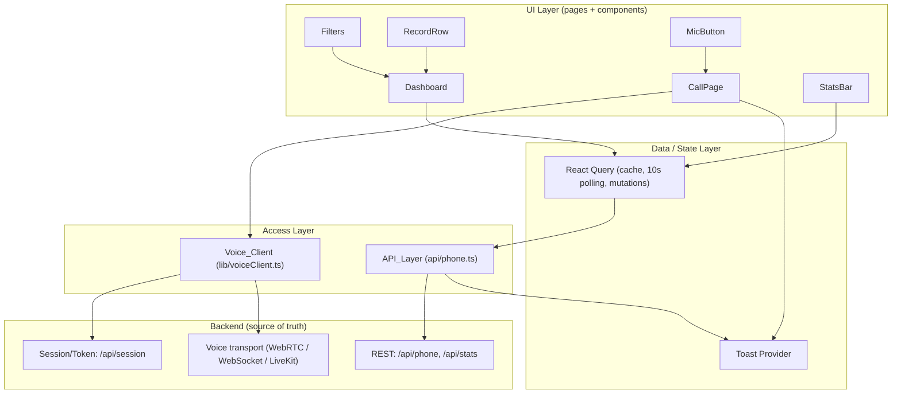
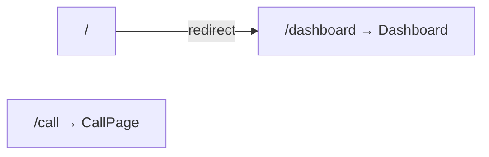
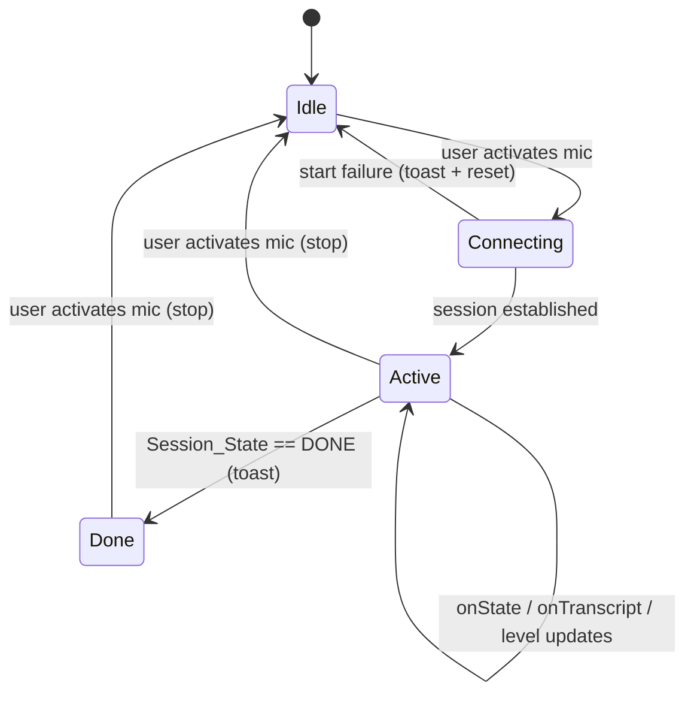
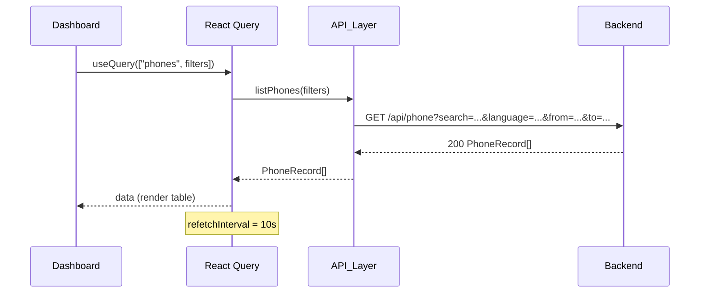
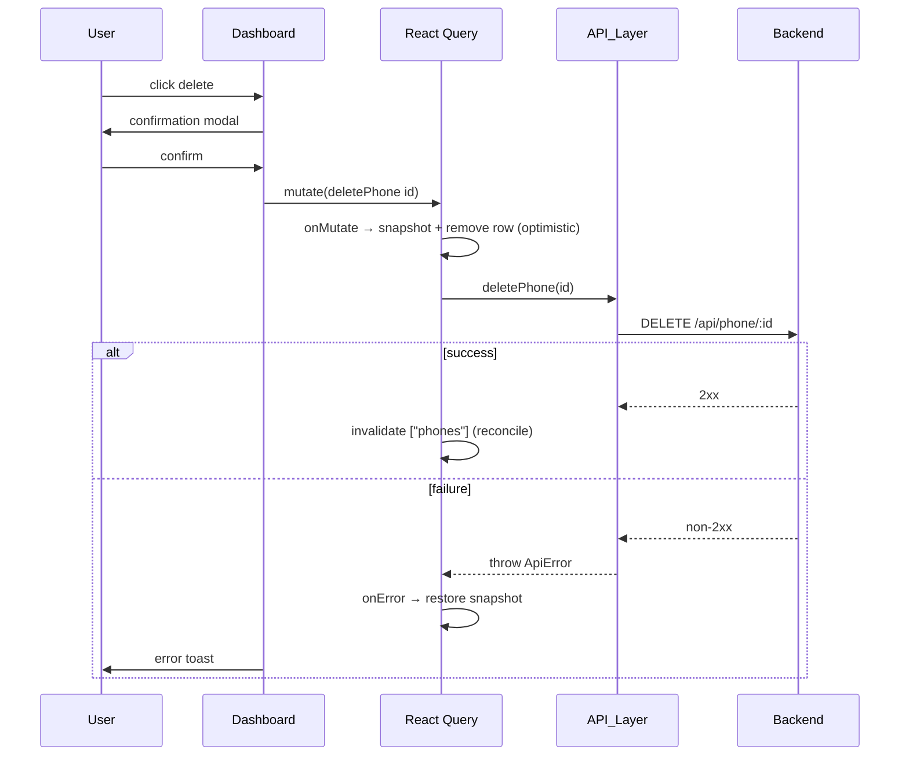

# Design Document

## Overview

The Voice Agent Dashboard is a React + Vite + TypeScript single-page application with two primary surfaces:

1. **Call Page** (`/call`) — lets a tester start/stop a voice session, watch the live transcript, follow the conversation state (`GREETING / COLLECTING / CONFIRMING / DONE`), see captured-digit progress, and view a microphone level meter.
2. **Dashboard Page** (`/dashboard`) — lists collected phone records with live refetch, substring/language/date filters, optimistic delete with confirmation, a stats bar, loading/empty states, and row expansion for the raw transcript.

The Backend is the authoritative source of truth. The Frontend performs **no** phone number parsing and keeps **no** client-side persistent storage; it reads from and writes to Backend HTTP endpoints and a voice session/token endpoint.

### Design Principles

- **Functional, not fancy.** Favor correctness and clarity over visual polish. Keep component surfaces small.
- **Thin, swappable seams.** The voice transport sits behind a single interface (`Voice_Client`) so Pipecat or LiveKit can be swapped without touching page code. The HTTP surface sits behind a single `API_Layer` so error handling and query-param construction live in one place.
- **Server-driven data.** React Query owns cache, refetch, and background updates; there is no bespoke client store for records.

### Key Technology Decisions

| Concern | Decision | Rationale |
| --- | --- | --- |
| Framework / build | React + Vite + TypeScript | Fast dev loop; matches Pipecat/LiveKit JS SDK examples. Mandated by `task.md`. |
| Routing | `react-router-dom` | Standard SPA routing with the three required routes (`/`, `/call`, `/dashboard`). |
| Data fetching | native `fetch` wrapped by `API_Layer`, orchestrated by **React Query** (`@tanstack/react-query`) | React Query gives caching, 10s polling, and background refetch "for free," making demo data look live without a hand-rolled store. |
| Styling | **Plain CSS Modules** | Chosen over Tailwind. The surface area is tiny (two pages, five components) and the explicit goal is "functional, not fancy." CSS Modules ship with Vite out of the box, require zero extra config/build tooling, provide locally-scoped class names, and keep the dependency footprint minimal. Dark/light via `prefers-color-scheme` is a few CSS lines. |
| Toasts | A minimal toast context/provider (in-app, no heavy dependency) | Error and completion notifications are required across pages; a shared provider avoids duplicating notification plumbing. A small library (e.g. `react-hot-toast`) is an acceptable swap, but a lightweight in-app provider keeps dependencies lean. |

### Styling Justification (brief)

CSS Modules win here because the app is small and the mandate is to avoid over-design. Tailwind would add a build step, config, and a utility-class learning surface for no proportional benefit at this scale. CSS Modules are native to Vite, scoped by default (no class collisions), and keep each component's styles colocated and readable.

## Architecture

### Layered View



### Routing



- `/` issues a redirect (`<Navigate to="/dashboard" replace />`) to satisfy Requirement 1.1.
- `/call` renders `CallPage` (Requirement 1.2).
- `/dashboard` renders `Dashboard` (Requirement 1.3).
- The Backend base URL is read once from `import.meta.env.VITE_API_URL` and provided to the `API_Layer` and `Voice_Client` (Requirement 1.4).

### Call Session State Machine (client view)

The Frontend does not drive the conversation; it reflects state emitted by the `Voice_Client`. The client-side session lifecycle is:



The conversation `Session_State` (`GREETING / COLLECTING / CONFIRMING / DONE`) is a value **inside** the `Active` phase, displayed as a badge; it is distinct from the client connection lifecycle above.

### Request/Response Flow — Dashboard load



### Optimistic Delete Flow



## Components and Interfaces

### Folder Layout

```
frontend/
├── src/
│   ├── main.tsx                 # React root, Router, QueryClientProvider, ToastProvider
│   ├── App.tsx                  # route table (/, /call, /dashboard)
│   ├── api/
│   │   └── phone.ts             # API_Layer: listPhones, deletePhone, getStats, createSession
│   ├── pages/
│   │   ├── CallPage.tsx         # start/stop, transcript, state badge, digit progress, mic meter
│   │   └── Dashboard.tsx        # query + filters + stats + table
│   ├── components/
│   │   ├── RecordRow.tsx        # one record row, expand to show rawTranscript, delete action
│   │   ├── Filters.tsx          # search box, language chips, date range
│   │   ├── StatsBar.tsx         # total + per-language tiles
│   │   └── MicButton.tsx        # mic toggle control + active state
│   ├── lib/
│   │   ├── voiceClient.ts       # Voice_Client interface + default transport impl
│   │   └── toast.tsx            # Toast context/provider/hook
│   └── types.ts                 # shared types (PhoneRecord, Stats, PhoneFilters, SessionState...)
├── index.html
├── vite.config.ts
├── package.json
└── .env.example                 # VITE_API_URL=http://localhost:8000
```

### API_Layer (`src/api/phone.ts`)

Centralizes all HTTP access. Builds query strings, parses JSON, and converts non-success responses into identifiable `ApiError`s. The `API_Layer` itself does not render toasts; it throws typed errors, and callers (React Query `onError` handlers / a shared error boundary) surface the toast. This keeps the layer pure and testable while still satisfying the "toast on failure" requirement at the integration seam.

```typescript
export interface PhoneFilters {
  search?: string;          // substring match against parsedNumber
  language?: LanguageTag;   // 'en' | 'hi' | 'mixed'; omitted means "all"
  from?: string;            // ISO date (inclusive lower bound)
  to?: string;              // ISO date (inclusive upper bound); omitted = open-ended
}

export class ApiError extends Error {
  constructor(
    public operation: string,   // e.g. 'listPhones', 'deletePhone'
    public status: number,
    message: string,
  ) {
    super(message);
    this.name = 'ApiError';
  }
}

// Pure helper: builds a query string from active filters only.
export function buildPhoneQuery(filters: PhoneFilters): string;

export function listPhones(filters: PhoneFilters): Promise<PhoneRecord[]>;
export function deletePhone(id: string): Promise<void>;
export function getStats(): Promise<Stats>;
export function createSession(): Promise<SessionDescriptor>; // GET/POST /api/session
```

Behavioral notes:
- `buildPhoneQuery` includes a parameter **only** when its filter value is active (non-empty / defined). `language === 'all'` is represented by omitting the `language` param entirely (Requirement 7.3). An absent `to` produces no upper-bound param (Requirement 7.5). All active filters appear together (Requirement 7.6).
- Every function wraps `fetch`; any non-2xx response throws an `ApiError` tagged with the operation name (Requirement 10.1).

### Voice_Client (`src/lib/voiceClient.ts`)

A transport-agnostic interface. Page code depends only on this interface; the concrete transport is chosen behind a factory so Pipecat or LiveKit can be swapped without changing `CallPage`.

```typescript
export type SessionState = 'GREETING' | 'COLLECTING' | 'CONFIRMING' | 'DONE';

export interface TranscriptEvent {
  text: string;
  isFinal: boolean;
}

export interface VoiceClient {
  start(): Promise<void>;
  stop(): Promise<void>;
  onTranscript(cb: (e: TranscriptEvent) => void): Unsubscribe;
  onState(cb: (state: SessionState) => void): Unsubscribe;
  onDigits(cb: (captured: number, expected: number) => void): Unsubscribe;
  onLevel(cb: (level: number) => void): Unsubscribe; // 0..1 mic input level
}

export type Unsubscribe = () => void;

// Factory selects the transport. Default = Pipecat/WebRTC bridge via /api/session.
export function createVoiceClient(config: VoiceClientConfig): VoiceClient;
```

Transport strategies (both conform to `VoiceClient`):
- **Pipecat / WebRTC-WebSocket (default):** calls `createSession()` to obtain a connection descriptor (WebRTC offer/answer or WebSocket URL) from the Backend `/api/session`, then streams mic audio and receives transcript/state/digit events over the data channel.
- **LiveKit:** fetches a token from the Backend, calls `Room.connect`, publishes the mic track, and subscribes to a data channel carrying transcript/state/digit payloads.

The `start/stop/onTranscript/onState` surface satisfies Requirement 2.4; `onDigits` and `onLevel` support Requirements 4.2 and 5.1. All `on*` methods return an `Unsubscribe` so `CallPage` can clean up on unmount.

### CallPage (`src/pages/CallPage.tsx`)

Owns the client session lifecycle (`Idle → Connecting → Active → Done`), subscribes to all `Voice_Client` events on mount, and unsubscribes on unmount.

Responsibilities / mapping:
- Mic toggle via `MicButton` → `start()`/`stop()` (Requirements 2.1, 2.2). On `start()` rejection, show error toast and reset to inactive (Requirement 2.3).
- Transcript panel appends final transcript segments and shows the latest interim text (Requirements 3.1, 3.2).
- State badge reflects `onState` (Requirement 4.1).
- Digit progress `captured / expected` from `onDigits` (Requirement 4.2).
- On `Session_State === 'DONE'`, show completion toast (Requirement 4.3).
- Mic level meter driven by `onLevel`, visible while active (Requirement 5.1).

### Dashboard (`src/pages/Dashboard.tsx`)

Composes `Filters`, `StatsBar`, and a table of `RecordRow`s. Holds filter state; passes it as the React Query key so changing a filter re-queries.

- `useQuery(['phones', filters], () => listPhones(filters), { refetchInterval: 10_000 })` (Requirements 6.1, 6.2).
- First-load `isLoading` → skeleton (Requirement 6.4); empty array → empty state (Requirement 6.5).
- `useQuery(['stats'], getStats)` feeds `StatsBar` (Requirement 9.1).
- `useMutation(deletePhone, { onMutate, onError, onSettled })` implements optimistic delete with snapshot restore (Requirements 8.2, 8.3, 8.5).

### Filters (`src/components/Filters.tsx`)

Controlled component emitting a `PhoneFilters` object upward.
- Search box → `search` (substring, Requirement 7.1).
- Language chips `all / en / hi / mixed`; `all` clears `language` (Requirements 7.2, 7.3).
- Date range `from` / `to`, with `to` optional for open-ended upper bound (Requirements 7.4, 7.5).

### StatsBar (`src/components/StatsBar.tsx`)

Renders four tiles — Total, English, Hindi, Mixed (Requirement 9.2). If the stats payload is missing/malformed such that tiles cannot render, shows an explicit error/empty state (Requirement 9.3).

### RecordRow (`src/components/RecordRow.tsx`)

Displays `parsedNumber`, `language`, `collectedAt`, and a delete action. Clicking the row toggles expansion to reveal `rawTranscript` (Requirement 6.6). Delete action opens the confirmation modal owned by the Dashboard (Requirement 8.1). Values are rendered exactly as received (Requirement 11.1).

### MicButton (`src/components/MicButton.tsx`)

A toggle control reflecting active/inactive state, delegating activation to `CallPage`.

## Data Models

```typescript
// src/types.ts

export type LanguageTag = 'en' | 'hi' | 'mixed';

export interface PhoneRecord {
  id: string;
  parsedNumber: string;   // rendered verbatim; never parsed on the client
  language: LanguageTag;
  collectedAt: string;    // ISO 8601 timestamp from Backend
  rawTranscript: string;  // shown on row expand
}

export interface Stats {
  total: number;
  byLanguage: {
    en: number;
    hi: number;
    mixed: number;
  };
}

export type LanguageChip = 'all' | LanguageTag;

export interface PhoneFilters {
  search?: string;
  language?: LanguageTag;  // undefined == 'all'
  from?: string;           // ISO date, inclusive lower bound
  to?: string;             // ISO date, inclusive upper bound; undefined == open-ended
}

export type SessionState = 'GREETING' | 'COLLECTING' | 'CONFIRMING' | 'DONE';

export interface SessionDescriptor {
  // Shape depends on transport; e.g. { url } for WS, { token, roomUrl } for LiveKit,
  // or an SDP answer for raw WebRTC. Treated as opaque config by CallPage.
  [key: string]: unknown;
}
```

Notes:
- All record data originates from the Backend; no field is derived or persisted on the client (Requirement 11).
- `collectedAt` is treated as an opaque ISO string for display and date-range comparison; the client does not reformat the number.

## Correctness Properties

*A property is a characteristic or behavior that should hold true across all valid executions of a system — essentially, a formal statement about what the system should do. Properties serve as the bridge between human-readable specifications and machine-verifiable correctness guarantees.*

These properties apply to the **pure logic seams** of this frontend: query-string construction, optimistic list transformations, the transcript-accumulation reducer, and record/stat rendering. UI chrome, routing, polling intervals, and voice transport are covered by example/integration/smoke tests (see Testing Strategy) because they either test external services or do not vary meaningfully with input.

Each property below was derived from the prework analysis and consolidates overlapping acceptance criteria to avoid redundancy.

### Property 1: Query construction reflects exactly the active filters

*For any* `PhoneFilters` value, `buildPhoneQuery(filters)` SHALL emit exactly one query parameter for each active filter (non-empty `search`, a concrete `language` other than `all`, a defined `from`, a defined `to`) with that filter's value, and SHALL omit a parameter for every inactive filter (empty/undefined `search`, `language === 'all'`, undefined `from`, undefined `to`). Parsing the produced query string back SHALL yield exactly the active filter set (round-trip).

**Validates: Requirements 7.1, 7.2, 7.3, 7.4, 7.5, 7.6**

### Property 2: Records are rendered verbatim and completely

*For any* list of `PhoneRecord`s, the rendered table SHALL contain, for every record, that record's `parsedNumber`, `language`, and `collectedAt` rendered byte-for-byte equal to the Backend-provided values, with no client-side transformation of the number.

**Validates: Requirements 6.3, 11.1**

### Property 3: Transcript accumulation preserves order and latest interim text

*For any* sequence of transcript events, the transcript reducer SHALL produce a view in which every final segment appears in emission order, and the displayed interim text equals the text of the most recently emitted interim event (last-write-wins).

**Validates: Requirements 3.1, 3.2**

### Property 4: Optimistic delete removes exactly the targeted record

*For any* list of `PhoneRecord`s and any `id` present in that list, the optimistic-remove transformation SHALL return a list that excludes the record with that `id` and preserves every other record unchanged and in its original relative order.

**Validates: Requirements 8.3**

### Property 5: Delete rollback is an identity round-trip

*For any* list of `PhoneRecord`s and any `id` present in that list, taking a snapshot, applying optimistic-remove, and then restoring the snapshot on failure SHALL yield a list equal to the original list in both contents and element order.

**Validates: Requirements 8.5**

### Property 6: Row expansion reveals the record's raw transcript

*For any* `PhoneRecord`, when its row is expanded, the rendered output SHALL contain that record's `rawTranscript` text.

**Validates: Requirements 6.6**

### Property 7: Stats tiles reflect the stats payload

*For any* valid `Stats` object, the `Stats_Bar` SHALL render four tiles whose displayed values equal `total`, `byLanguage.en`, `byLanguage.hi`, and `byLanguage.mixed` respectively.

**Validates: Requirements 9.2**

### Property 8: API failures raise identifiable errors

*For any* `API_Layer` operation and any non-success HTTP status, invoking that operation SHALL throw an `ApiError` whose `operation` field identifies the failed call and whose `status` field equals the returned status.

**Validates: Requirements 10.1**

## Error Handling

### HTTP / API errors

- Every `API_Layer` function inspects the `fetch` response. A non-2xx status (or a network/`fetch` rejection) is converted into an `ApiError(operation, status, message)` (Requirement 10.1).
- The `API_Layer` throws; it never silently resolves. Callers surface the error:
  - React Query `useQuery`/`useMutation` `onError` handlers call the toast hook (Requirements 10.2, 2.3, 8.5).
  - For deletes, `onError` additionally restores the pre-mutation snapshot (Requirement 8.5).
- A single shared toast provider renders notifications so error handling is consistent across pages.

### Voice session errors

- `Voice_Client.start()` rejects if session negotiation (`/api/session` or LiveKit token/connect) fails. `CallPage` catches the rejection, shows an error toast, and resets the control to inactive (Requirement 2.3).
- Mid-session transport errors (e.g., socket close) transition the UI back to `Idle` and surface a toast.

### Malformed stats

- `StatsBar` validates that the stats payload has the four renderable values. If missing/malformed, it renders an explicit error/empty state instead of crashing (Requirement 9.3).

### Empty and loading states

- First-load pending → skeleton (Requirement 6.4). Empty result array → empty-state message (Requirement 6.5). These are treated as normal states, not errors.

### Defensive rendering

- Record fields are rendered as received; the client performs no parsing or coercion of `parsedNumber`/`language` (Requirement 11.1). Unexpected/extra fields are ignored.

## Testing Strategy

A dual approach: **property-based tests** verify the universal properties above over many generated inputs; **example / edge-case / integration / smoke tests** cover specific scenarios, external wiring, and configuration.

### Tooling

- **Test runner:** Vitest (native to the Vite ecosystem).
- **Component tests:** React Testing Library + `@testing-library/user-event`.
- **Property-based testing:** `fast-check` (the standard PBT library for TypeScript). Properties are NOT hand-rolled; `fast-check` generates inputs.
- **Network:** `fetch` mocked (e.g., via MSW or a `vi.fn()` fetch stub). The `Voice_Client` is mocked in `CallPage` tests.

### Property-Based Tests (minimum 100 iterations each)

Each property test runs a minimum of **100 iterations** and is tagged with a comment referencing the design property. Tag format:
`// Feature: voice-agent-dashboard, Property {number}: {property_text}`

| Property | Target under test | Generators |
| --- | --- | --- |
| 1 | `buildPhoneQuery` (+ reverse-parse) | arbitrary `PhoneFilters` (optional search, language ∈ {all,en,hi,mixed}, optional from/to) |
| 2 | table/row record rendering | arrays of arbitrary `PhoneRecord` (incl. special chars, empty transcript) |
| 3 | transcript reducer | sequences of interim/final `TranscriptEvent`s |
| 4 | optimistic-remove function | arbitrary record list + an id drawn from the list |
| 5 | snapshot → remove → restore | arbitrary record list + an id drawn from the list |
| 6 | row expansion render | arbitrary `PhoneRecord` |
| 7 | `StatsBar` rendering | arbitrary valid `Stats` |
| 8 | `API_Layer` error tagging | arbitrary operation + arbitrary non-2xx status |

Generators should include edge inputs (empty strings, whitespace, non-ASCII/Hindi text, empty lists, single-element lists, large lists) so edge-case criteria (6.5, 9.3) are exercised by the property generators where applicable.

### Example-Based Unit / Component Tests

- Routing: `/` redirects to `/dashboard`; `/call` renders CallPage; `/dashboard` renders Dashboard (Requirements 1.1–1.3).
- Mic toggle start/stop transitions with mocked `Voice_Client` (Requirements 2.1, 2.2).
- State badge shows each of the four `SessionState` values (Requirement 4.1).
- Digit progress renders `captured / expected` (Requirement 4.2).
- DONE emits completion toast (Requirement 4.3).
- Mic level meter reflects emitted levels while active (Requirement 5.1).
- Loading skeleton on first load (Requirement 6.4).
- Delete confirmation modal appears; cancel retains record and issues no DELETE (Requirements 8.1, 8.4).

### Edge-Case Tests

- Start failure → error toast + control reset (Requirement 2.3).
- Empty record list → empty-state message (Requirement 6.5).
- Malformed/missing stats payload → error/empty state, no crash (Requirement 9.3).

### Integration Tests

- Dashboard mount triggers `GET /api/phone` and `GET /api/stats` (Requirements 6.1, 9.1).
- 10-second refetch using fake timers (Requirement 6.2).
- Confirmed delete issues `DELETE /api/phone/:id` (Requirement 8.2).
- Forced API error surfaces an error toast (Requirement 10.2).

### Smoke Tests

- `API_Layer` composes request URLs from `VITE_API_URL` (Requirement 1.4).
- `createVoiceClient()` returns an object exposing `start`, `stop`, `onTranscript`, `onState` (Requirement 2.4).
- No client-side persistence of records (no `localStorage`/`IndexedDB` writes of record data); data is sourced from the `API_Layer` (Requirement 11.2).

### Notes

- Unit/property tests focus on the pure logic seams; the component tests mock the transport and network so the UI logic is tested in isolation from external services.
- Property tests cover universal correctness; example and integration tests cover concrete wiring and user interactions. Together they provide comprehensive coverage without over-testing low-cardinality UI mappings.
