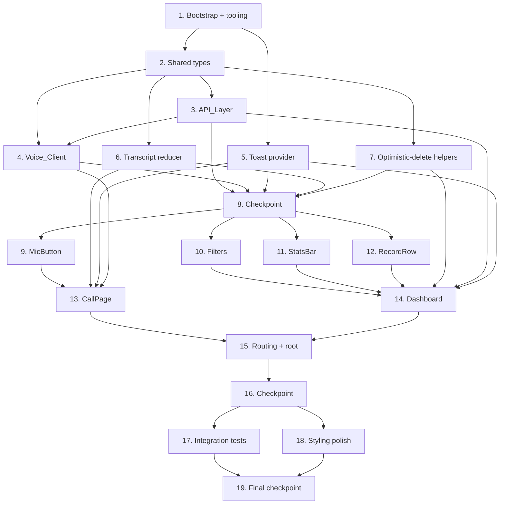

# Implementation Plan: Voice Agent Dashboard

## Overview

This plan builds the Voice Agent Dashboard incrementally in TypeScript/React following the approved design. The sequence starts with project bootstrap and shared types, then builds the pure access-layer seams (API_Layer, Voice_Client) that the correctness properties target, then the toast provider, then components, then pages, then routing/wiring, and finishes with styling polish. Each task builds on prior tasks so there is no orphaned code: lower layers are consumed by the components and pages that follow.

Property-based tests (fast-check, ≥100 iterations) are placed as sub-tasks next to the pure logic they validate so bugs are caught early. All test sub-tasks are marked optional with `*`. The Backend remains the source of truth: the Frontend performs no phone parsing and keeps no client-side persistence of records.

## Tasks

- [x] 1. Bootstrap the project and tooling
  - Scaffold a Vite + React + TypeScript app in `frontend/` (`index.html`, `src/main.tsx`, `vite.config.ts`, `package.json`, `tsconfig.json`).
  - Add dependencies: `react-router-dom`, `@tanstack/react-query`.
  - Add dev/test dependencies: `vitest`, `@testing-library/react`, `@testing-library/user-event`, `@testing-library/jest-dom`, `jsdom`, `fast-check`.
  - Configure Vitest in `vite.config.ts` (jsdom environment, globals, setup file registering jest-dom matchers).
  - Confirm CSS Modules work out of the box (no extra config); add a base `src/index.css` with a `prefers-color-scheme` dark/light root.
  - Create `.env.example` with `VITE_API_URL=http://localhost:8000`.
  - _Requirements: 1.4_

- [x] 2. Define shared types
  - Create `src/types.ts` with `LanguageTag`, `PhoneRecord`, `Stats`, `LanguageChip`, `PhoneFilters`, `SessionState`, and `SessionDescriptor` exactly as specified in the design Data Models section.
  - _Requirements: 11.1, 11.2_

- [x] 3. Implement the API_Layer
  - [x] 3.1 Implement `ApiError`, `buildPhoneQuery`, and the fetch wrapper
    - Create `src/api/phone.ts` with the `ApiError` class (`operation`, `status`, `message`).
    - Implement `buildPhoneQuery(filters: PhoneFilters): string` emitting a query param only for each active filter (non-empty `search`, concrete `language` other than `all`, defined `from`, defined `to`); omit `language` when `all`; omit `to` for open-ended upper bound.
    - Implement a shared fetch helper that reads the base URL from `import.meta.env.VITE_API_URL` and converts any non-2xx response or network rejection into an `ApiError` tagged with the operation name and status.
    - _Requirements: 1.4, 7.1, 7.2, 7.3, 7.4, 7.5, 7.6, 10.1_

  - [x]* 3.2 Write property test for query construction
    - **Property 1: Query construction reflects exactly the active filters**
    - Generate arbitrary `PhoneFilters`; assert each active filter appears once and each inactive filter is omitted; reverse-parse the query string and assert it equals the active filter set (round-trip). fast-check, ≥100 iterations.
    - Tag: `// Feature: voice-agent-dashboard, Property 1: Query construction reflects exactly the active filters`
    - **Validates: Requirements 7.1, 7.2, 7.3, 7.4, 7.5, 7.6**

  - [x] 3.3 Implement `listPhones`, `deletePhone`, `getStats`, and `createSession`
    - `listPhones(filters)` → `GET /api/phone` + `buildPhoneQuery`; `deletePhone(id)` → `DELETE /api/phone/:id`; `getStats()` → `GET /api/stats`; `createSession()` → `/api/session`. Each throws `ApiError` on non-success.
    - _Requirements: 6.1, 7.6, 8.2, 9.1, 10.1_

  - [x]* 3.4 Write property test for API error tagging
    - **Property 8: API failures raise identifiable errors**
    - Generate an arbitrary operation and arbitrary non-2xx status with a mocked fetch; assert the thrown `ApiError` carries the matching `operation` and `status`. fast-check, ≥100 iterations.
    - Tag: `// Feature: voice-agent-dashboard, Property 8: API failures raise identifiable errors`
    - **Validates: Requirements 10.1**

  - [x]* 3.5 Write smoke/unit tests for the API_Layer wiring
    - Verify request URLs are composed from `VITE_API_URL` (Requirement 1.4).
    - Verify no record data is written to `localStorage`/`IndexedDB` (Requirement 11.2).
    - _Requirements: 1.4, 11.2_

- [x] 4. Implement the Voice_Client interface and factory
  - [x] 4.1 Define the `VoiceClient` interface, event types, and `createVoiceClient` factory
    - Create `src/lib/voiceClient.ts` with `SessionState`, `TranscriptEvent`, `Unsubscribe`, the `VoiceClient` interface (`start`, `stop`, `onTranscript`, `onState`, `onDigits`, `onLevel`), and `createVoiceClient(config)`.
    - Implement the default transport using `createSession()` from the API_Layer; expose event subscriptions that return `Unsubscribe` callbacks.
    - _Requirements: 2.4, 4.2, 5.1_

  - [x]* 4.2 Write smoke test for the factory surface
    - Assert `createVoiceClient()` returns an object exposing `start`, `stop`, `onTranscript`, `onState`.
    - _Requirements: 2.4_

- [x] 5. Implement the toast provider
  - Create `src/lib/toast.tsx` with a toast context, `ToastProvider`, and `useToast` hook exposing a method to show error and completion notifications.
  - Keep it lightweight and in-app (no heavy dependency).
  - _Requirements: 2.3, 4.3, 8.5, 10.2_

- [x] 6. Implement the transcript reducer
  - [x] 6.1 Implement a pure transcript-accumulation reducer
    - In `src/lib/` (e.g. `transcript.ts`), implement a reducer that appends final segments in emission order and keeps the latest interim text (last-write-wins).
    - _Requirements: 3.1, 3.2_

  - [x]* 6.2 Write property test for transcript accumulation
    - **Property 3: Transcript accumulation preserves order and latest interim text**
    - Generate sequences of interim/final `TranscriptEvent`s; assert final segments appear in order and the displayed interim equals the most recent interim event. fast-check, ≥100 iterations.
    - Tag: `// Feature: voice-agent-dashboard, Property 3: Transcript accumulation preserves order and latest interim text`
    - **Validates: Requirements 3.1, 3.2**

- [x] 7. Implement optimistic-delete list helpers
  - [x] 7.1 Implement pure `removeById` and snapshot/restore helpers
    - In `src/lib/` (e.g. `records.ts`), implement a function that removes exactly the record with a given id while preserving order of the others, plus snapshot/restore helpers used by the delete mutation.
    - _Requirements: 8.3, 8.5_

  - [x]* 7.2 Write property test for optimistic remove
    - **Property 4: Optimistic delete removes exactly the targeted record**
    - Generate an arbitrary record list and an id drawn from it; assert the result excludes that record and preserves all others in original relative order. fast-check, ≥100 iterations.
    - Tag: `// Feature: voice-agent-dashboard, Property 4: Optimistic delete removes exactly the targeted record`
    - **Validates: Requirements 8.3**

  - [x]* 7.3 Write property test for delete rollback
    - **Property 5: Delete rollback is an identity round-trip**
    - Generate an arbitrary record list and an id drawn from it; snapshot, remove, then restore and assert equality with the original in contents and order. fast-check, ≥100 iterations.
    - Tag: `// Feature: voice-agent-dashboard, Property 5: Delete rollback is an identity round-trip`
    - **Validates: Requirements 8.5**

- [x] 8. Checkpoint - Ensure all tests pass
  - Ensure all tests pass, ask the user if questions arise.

- [x] 9. Implement the MicButton component
  - Create `src/components/MicButton.tsx` as a controlled toggle reflecting active/inactive state and delegating activation to its parent, with CSS Module styling.
  - _Requirements: 2.1, 2.2_

- [x] 10. Implement the Filters component
  - Create `src/components/Filters.tsx` as a controlled component emitting a `PhoneFilters` object: search box (`search` substring), language chips `all/en/hi/mixed` (`all` clears `language`), and `from`/`to` date inputs (`to` optional).
  - _Requirements: 7.1, 7.2, 7.3, 7.4, 7.5_

- [x] 11. Implement the StatsBar component
  - [x] 11.1 Render four tiles and the error/empty state
    - Create `src/components/StatsBar.tsx` rendering Total, English, Hindi, and Mixed tiles from a `Stats` payload; when the payload is missing/malformed such that tiles cannot render, show an explicit error/empty state.
    - _Requirements: 9.2, 9.3_

  - [x]* 11.2 Write property test for stats rendering
    - **Property 7: Stats tiles reflect the stats payload**
    - Generate arbitrary valid `Stats`; assert the four tiles display `total`, `byLanguage.en`, `byLanguage.hi`, `byLanguage.mixed`. fast-check, ≥100 iterations.
    - Tag: `// Feature: voice-agent-dashboard, Property 7: Stats tiles reflect the stats payload`
    - **Validates: Requirements 9.2**

  - [x]* 11.3 Write edge-case test for malformed stats
    - Missing/malformed stats payload renders an error/empty state without crashing.
    - _Requirements: 9.3_

- [x] 12. Implement the RecordRow component
  - [x] 12.1 Render a record row with expansion and delete action
    - Create `src/components/RecordRow.tsx` displaying `parsedNumber`, `language`, `collectedAt` verbatim; clicking the row toggles expansion to reveal `rawTranscript`; delete action requests the parent's confirmation flow. No client-side transformation of values.
    - _Requirements: 6.3, 6.6, 8.1, 11.1_

  - [x]* 12.2 Write property test for verbatim record rendering
    - **Property 2: Records are rendered verbatim and completely**
    - Generate arrays of arbitrary `PhoneRecord` (incl. special chars, non-ASCII/Hindi, empty transcript); assert every record's `parsedNumber`, `language`, `collectedAt` render byte-for-byte equal to inputs. fast-check, ≥100 iterations.
    - Tag: `// Feature: voice-agent-dashboard, Property 2: Records are rendered verbatim and completely`
    - **Validates: Requirements 6.3, 11.1**

  - [x]* 12.3 Write property test for row expansion
    - **Property 6: Row expansion reveals the record's raw transcript**
    - Generate arbitrary `PhoneRecord`; expand the row and assert the rendered output contains `rawTranscript`. fast-check, ≥100 iterations.
    - Tag: `// Feature: voice-agent-dashboard, Property 6: Row expansion reveals the record's raw transcript`
    - **Validates: Requirements 6.6**

- [x] 13. Implement the CallPage
  - [x] 13.1 Wire the session lifecycle and Voice_Client subscriptions
    - Create `src/pages/CallPage.tsx` owning the `Idle → Connecting → Active → Done` lifecycle; subscribe to `onTranscript`, `onState`, `onDigits`, `onLevel` on mount and unsubscribe on unmount.
    - Mic toggle (MicButton) calls `start()`/`stop()`; on `start()` rejection show an error toast and reset to inactive.
    - Transcript panel uses the reducer from Task 6; state badge from `onState`; digit progress `captured / expected` from `onDigits`; completion toast on `DONE`; mic level meter from `onLevel` while active.
    - _Requirements: 2.1, 2.2, 2.3, 3.1, 3.2, 4.1, 4.2, 4.3, 5.1_

  - [x]* 13.2 Write component tests for CallPage interactions (mocked Voice_Client)
    - Mic toggle start/stop transitions; state badge for each of the four `SessionState` values; digit progress render; DONE completion toast; mic level meter reflects emitted levels while active.
    - _Requirements: 2.1, 2.2, 4.1, 4.2, 4.3, 5.1_

  - [x]* 13.3 Write edge-case test for start failure
    - `start()` rejection shows an error toast and resets the control to inactive.
    - _Requirements: 2.3_

- [x] 14. Implement the Dashboard page
  - [x] 14.1 Wire queries, filters, stats, and the record table
    - Create `src/pages/Dashboard.tsx` holding filter state and composing `Filters`, `StatsBar`, and a table of `RecordRow`s.
    - `useQuery(['phones', filters], () => listPhones(filters), { refetchInterval: 10_000 })`; first-load `isLoading` → skeleton; empty array → empty state.
    - `useQuery(['stats'], getStats)` feeds `StatsBar`.
    - _Requirements: 6.1, 6.2, 6.3, 6.4, 6.5, 7.6, 9.1_

  - [x] 14.2 Implement optimistic delete with confirmation modal
    - Add a confirmation modal; on confirm run `useMutation(deletePhone, { onMutate, onError, onSettled })` using the helpers from Task 7 to optimistically remove, invalidate on success, restore snapshot and toast on failure; cancel retains the record and issues no DELETE.
    - _Requirements: 8.1, 8.2, 8.3, 8.4, 8.5, 10.2_

  - [x]* 14.3 Write component tests for Dashboard states
    - Loading skeleton on first load (6.4); empty-state message on empty list (6.5); confirmation modal appears and cancel retains record with no DELETE (8.1, 8.4).
    - _Requirements: 6.4, 6.5, 8.1, 8.4_

- [x] 15. Wire routing and application root
  - Create `src/App.tsx` with the route table: `/` → `<Navigate to="/dashboard" replace />`, `/call` → `CallPage`, `/dashboard` → `Dashboard`.
  - Update `src/main.tsx` to mount the React root wrapped in `BrowserRouter`, `QueryClientProvider`, and `ToastProvider`.
  - _Requirements: 1.1, 1.2, 1.3_

  - [x]* 15.1 Write routing component tests
    - `/` redirects to `/dashboard`; `/call` renders CallPage; `/dashboard` renders Dashboard.
    - _Requirements: 1.1, 1.2, 1.3_

- [x] 16. Checkpoint - Ensure all tests pass
  - Ensure all tests pass, ask the user if questions arise.

- [x] 17. Write integration tests for data wiring
  - [x]* 17.1 Dashboard mount triggers backend reads
    - Assert mounting Dashboard issues `GET /api/phone` and `GET /api/stats` (mocked fetch).
    - _Requirements: 6.1, 9.1_

  - [x]* 17.2 10-second refetch and confirmed delete
    - Use fake timers to assert the 10s refetch (6.2); assert confirmed delete issues `DELETE /api/phone/:id` (8.2); forced API error surfaces an error toast (10.2).
    - _Requirements: 6.2, 8.2, 10.2_

- [x] 18. Styling polish
  - Add CSS Modules for mobile-friendly table layout, monospace digits for `parsedNumber`/digit progress, and `prefers-color-scheme` dark/light handling across pages and components.
  - _Requirements: 6.3_

- [x] 19. Final checkpoint - Ensure all tests pass
  - Ensure all tests pass, ask the user if questions arise.

## Task Dependency Graph



```json
{
  "waves": [
    { "wave": 1, "tasks": ["1"] },
    { "wave": 2, "tasks": ["2"] },
    { "wave": 3, "tasks": ["3", "5", "6", "7"] },
    { "wave": 4, "tasks": ["4"] },
    { "wave": 5, "tasks": ["8"] },
    { "wave": 6, "tasks": ["9", "10", "11", "12"] },
    { "wave": 7, "tasks": ["13", "14"] },
    { "wave": 8, "tasks": ["15"] },
    { "wave": 9, "tasks": ["16"] },
    { "wave": 10, "tasks": ["17", "18"] },
    { "wave": 11, "tasks": ["19"] }
  ]
}
```

## Notes

- Tasks marked with `*` are optional test sub-tasks and can be skipped for a faster MVP; core implementation sub-tasks are never optional.
- Property tests use `fast-check` with a minimum of 100 iterations each and are tagged `// Feature: voice-agent-dashboard, Property {n}: {property_text}` referencing the design's Correctness Properties.
- Each task references specific requirement numbers and/or design properties for traceability.
- Constraints honored throughout: no frontend phone parsing (values rendered verbatim) and no client-side persistence of records (data sourced from the Backend via the API_Layer).
